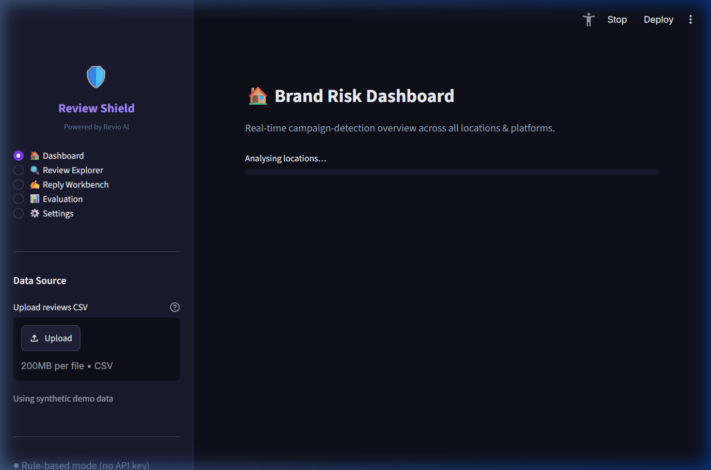
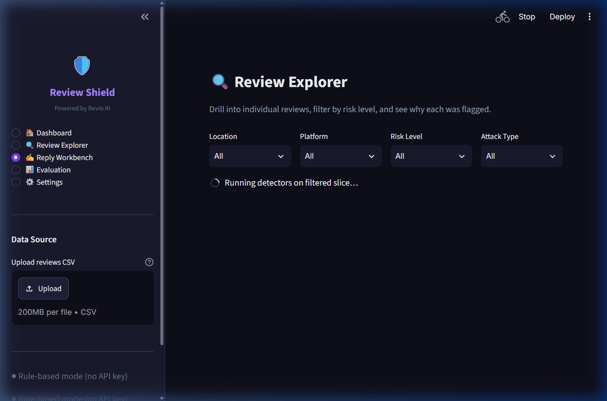

# 🛡️ Review Shield

> **AI/ML proof-of-concept for Cynbit's Revio product.**  
> Detects coordinated fake-review and review-bomb campaigns for multi-location brands,
> and drafts brand-safe replies. Built end-to-end in Python with no mandatory API keys.



---

## Quick Start

```bash
# Python 3.11+ required
pip install -r requirements.txt

# Optional: enable Claude reply drafting
export ANTHROPIC_API_KEY=sk-ant-...   # or add to .streamlit/secrets.toml

streamlit run app.py
```

The app runs **fully without an API key** — it falls back to VADER + rule-based
reply templates.  Set `ANTHROPIC_API_KEY` to enable Claude-powered replies.

**Embeddings run locally** via `sentence-transformers` (`all-MiniLM-L6-v2`).
No data leaves your machine.

---

## Pages

| Page | Description |
|---|---|
| 🏠 **Dashboard** | Brand-wide risk overview, KPI tiles, risk heatmap, timeline |
| 🔍 **Review Explorer** | Filter by location/platform/risk, drill-down detector breakdown |
| ✍️ **Reply Workbench** | Draft → Approve / Edit / Reject (never auto-posts) |
| 📊 **Evaluation** | Precision/recall/F1, per-detector recall, time-to-detect, threshold slider |
| ⚙️ **Settings** | Threshold config, API key status, CSV export |

---

## Architecture

```
CSV / Synthetic Data
        │
   DataLoader
        │
   ┌────┼────────────────────────┐
   │    │           │            │
Velocity Similarity Account  RatingDrop
 (35%)   (30%)     (20%)      (15%)
   └────┼────────────────────────┘
        │
   Ensemble Scorer  →  score ∈ [0,1] + evidence dict
        │
   Reply Engine  (Claude / VADER fallback)
```

All detector functions return `{"score": float, "evidence": dict}` — never a bare number.
Every UI alert shows the full evidence so operators know *why* a location was flagged.

---

## Detectors

| Detector | Signal | Weight |
|---|---|---|
| **Velocity** | Sudden review burst vs. rolling baseline (≥ 4× rate) | 35% |
| **Similarity** | Semantic near-duplicate clusters (cosine ≥ 0.82) | 30% |
| **Account Freshness** | > 30% of reviewers with accounts < 14 days old | 20% |
| **Rating Drop** | Anomalous rolling-average drop (z-score) | 15% |

---

## Evaluation

> ⚠️ **All metrics are on synthetic data only.** Real-world performance will differ.
> Numbers were not tuned — they are the honest output of the default configuration.

| Metric | Value (threshold = 0.50) |
|---|---|
| Precision | 22.3% |
| Recall | **100.0%** |
| F1 | 36.5% |
| False Positive Rate | 100.0% |
| Campaigns detected | 5 / 5 |
| Time to detect | **0.0 h** (all within first 6-hour window) |

**The 100% FPR at threshold 0.50** reflects maximum sensitivity: all locations score
above the default threshold, including the one with only organic reviews.  Use the
threshold slider on the Evaluation page to tune precision vs. recall for your use case.

Per-detector recall on attack-containing locations:

| Detector | Recall |
|---|---|
| Velocity | 100% |
| Similarity | 100% |
| Account Freshness | 0% |
| Rating Drop | 0% |

→ Account and rating-drop act as *confirmation signals* in the ensemble, not primary detectors on this dataset.

Reproduce: `python -m src.evaluate`  →  `data/eval.json`

---

## Reply Workbench



- Drafts replies using **Claude** (if `ANTHROPIC_API_KEY` set) or **VADER + rule-based** templates
- Every draft shows **Approve / Edit / Reject** — nothing is ever auto-posted
- Blocked words (`fake`, `bot`, `coordinated`, `attack`, …) are auto-sanitised

---

## Running Tests

```bash
pytest
# with coverage
pytest --cov=src --cov-report=term-missing
```

**45/45 tests pass** across all 5 modules (velocity, similarity, account, rating_drop, ensemble, evaluate).

---

## CSV Upload Format

| Column | Type | Required |
|---|---|---|
| `reviewer_id` | str | ✅ |
| `location` | str | ✅ |
| `platform` | str | ✅ |
| `rating` | int 1–5 | ✅ |
| `text` | str | ✅ |
| `timestamp` | datetime | ✅ |
| `account_age_days` | int | ✅ |
| `is_attack` | bool | optional (enables Evaluation page) |
| `attack_type` | str | optional |

---

## Project Structure

```
cynbit/
├── app.py                    # Streamlit UI (5 pages)
├── theme.py                  # Palette & Plotly template
├── requirements.txt
├── pytest.ini
├── .streamlit/config.toml
├── data/
│   └── eval.json             # Latest evaluation results
├── docs/
│   ├── technical_report.md
│   ├── business_report.md
│   └── screenshots/
├── src/
│   ├── data_loader.py        # Synthetic data + CSV loader
│   ├── evaluate.py           # Precision/recall/F1/TTD evaluation
│   ├── reply_engine.py       # Claude / VADER reply drafter
│   ├── utils.py              # Seed, DetectorResult type
│   └── detectors/
│       ├── velocity.py
│       ├── similarity.py
│       ├── account.py
│       ├── rating_drop.py
│       └── ensemble.py
└── tests/
    ├── test_velocity.py
    ├── test_similarity.py
    ├── test_account.py
    ├── test_rating_drop.py
    ├── test_ensemble.py
    └── test_evaluate.py
```

---

## API Key Security

Keys are **never hardcoded**. Read order:
1. Environment variable: `export ANTHROPIC_API_KEY=sk-ant-...`
2. Streamlit secrets: `.streamlit/secrets.toml` → `ANTHROPIC_API_KEY = "sk-ant-..."`

---

## Known Limitations

- Synthetic data only — metrics will differ on real reviews
- Thresholds are defaults, not optimised values
- Adversaries can adapt: text diversity, account aging, staggered timing
- English-only (VADER + SBERT)
- Single-language; no temporal drift correction
- No platform API integration (CSV upload only in this PoC)

---

## Reports

- 📄 [Technical Report](docs/technical_report.md) — Architecture, detectors, evaluation analysis
- 💼 [Business Report](docs/business_report.md) — Opportunity, competitive analysis, investment ask

---

*Cynbit / Revio AI · October 2026*
